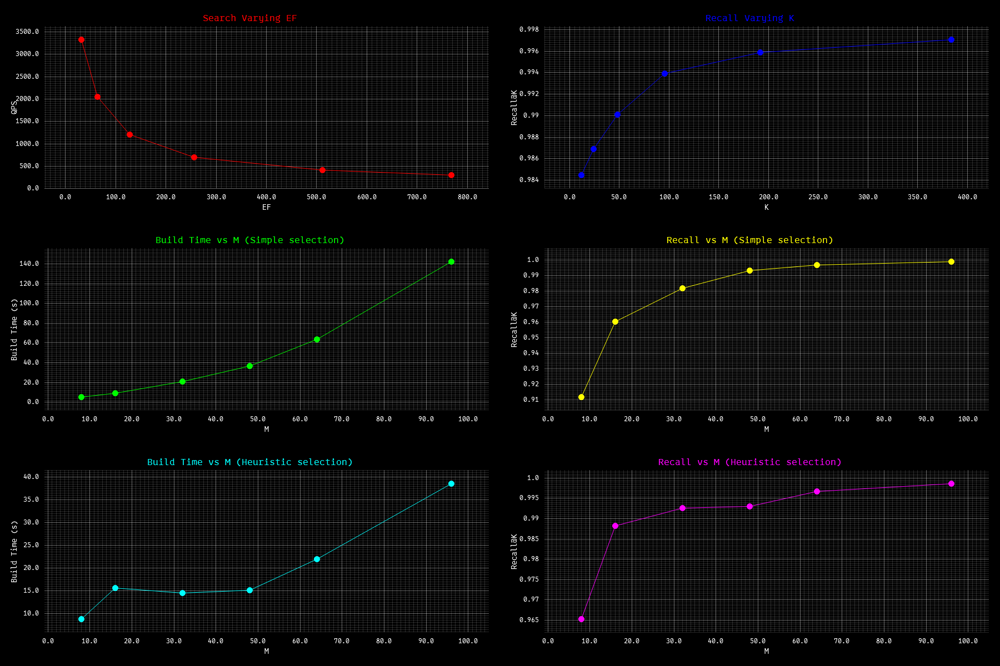
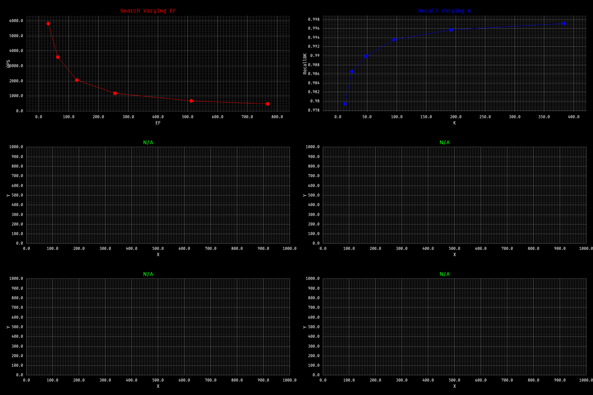

**Generic** implementation of **HNSW (Hierarchical Navigable Small World)** algorithm for approximate nearest neighbor
search. This is pretty much ["paper-compliant"](https://arxiv.org/pdf/1603.09320), its simplified, well documentated and
easy to understand & reason, while still being _reasonably_ efficient and robust, I guess. Its can be used to
`nearest-search` in _any SPACE_ with given distance valid metric, for examples: vector, string, locations, image, audio,
bioinformatics etc.

Checkout this repo: [blaze-db](https://github.com/ronakgh97/blaze-db), [ARCHIVED/ABANDON]
a vector database built on top of this HNSW implementation.

**How to bench**?

Make sure to have cargo & this [dataset](https://huggingface.co/datasets/KShivendu/dbpedia-entities-openai-1M), and also
change [build config](.cargo/config.toml).

```shell
cargo bench --bench (32bit or 8bit)  -- ../../datasets/dim1536_size1M 4 # 32bit takes around 10+ mins!!!
                              <path to dataset> <num of files to read>
```

> NOTE; This lib uses [Portable SIMD](https://docs.rs/wide/1.6.0/wide/index.html)
> and [x86_64 intrinsics](https://doc.rust-lang.org/core/arch/x86_64/index.html)
> for vector operations, so _peak performance_ can't be guaranteed on non-x86_64 targets, but it should still work &
> compile due to #[cfg].

Benched on I7 14650hx (rust 1.97.1, target: x86_64-pc-windows-msvc)

**_F32 Bench_**

```shell
# Alg. 3 (simple, paper default): max_n: 16, ef_const: 96, max_l: 18, metrics: cosine
Total vectors: 153848, dimension: 1536
Index built in 148.0973492s with 1039 insert/s
Size on disk: 988980701 bytes

Search with ef: 32 took, QPS: 3329.71
Search with ef: 64 took, QPS: 2048.05
Search with ef: 128 took, QPS: 1211.30
Search with ef: 256 took, QPS: 694.81
Search with ef: 512 took, QPS: 407.79
Search with ef: 768 took, QPS: 299.89

Recall@12: 0.9845, Time: 31.11563
Recall@24: 0.9869, Time: 31.486069
Recall@48: 0.9901, Time: 31.932785
Recall@96: 0.9939, Time: 33.085556
Recall@192: 0.9959, Time: 34.371452
Recall@384: 0.9971, Time: 37.14816

Simple selection
M: 8, Build Time: 5.0662s, Recall@32: 0.9117
M: 16, Build Time: 9.0834s, Recall@32: 0.9602
M: 32, Build Time: 20.6643s, Recall@32: 0.9816
M: 48, Build Time: 36.4946s, Recall@32: 0.9933
M: 64, Build Time: 63.7489s, Recall@32: 0.9966
M: 96, Build Time: 142.2620s, Recall@32: 0.9989

# same config varying M (Alg. 3), sample_size: 32540
# Note: ef_const IS scales with M (ef_const = max(96, 2*M)) during this run
Heuristic selection
M: 8, Build Time: 8.7727s, Recall@32: 0.9653
M: 16, Build Time: 15.5644s, Recall@32: 0.9882
M: 32, Build Time: 14.5613s, Recall@32: 0.9926
M: 48, Build Time: 15.0877s, Recall@32: 0.9931
M: 64, Build Time: 21.9785s, Recall@32: 0.9968
M: 96, Build Time: 38.5939s, Recall@32: 0.9986
```



**_I8 Bench_**

```shell
# same config as 32bit run
Total vectors: 153848, dimension: 1536
Index built in 112.3598634s with 1373 insert/s
Size on disk: 280084901 bytes

Search with ef: 32 took, QPS: 5831.94
Search with ef: 64 took, QPS: 3585.93
Search with ef: 128 took, QPS: 2057.23
Search with ef: 256 took, QPS: 1187.95
Search with ef: 512 took, QPS: 679.14
Search with ef: 768 took, QPS: 476.34

Recall@12: 0.9794, Time: 13.588794
Recall@24: 0.9865, Time: 13.800337
Recall@48: 0.9899, Time: 13.994714
Recall@96: 0.9936, Time: 14.575672
Recall@192: 0.9957, Time: 15.574082
Recall@384: 0.9971, Time: 16.763058

# other bench are not needed here, since they depend on the algorithm properties, not data type. 
```



> Last updated: 08/10/2026

**some observations**
on [commit](https://github.com/ronakgh97/hnsw-rs/commit/57aa9fd42877c267e22645d7821c1f671ed76896)

- `ef_const = max(96, 2*M)` ensures candidate pool scales with Mmax0 (2*M at layer 0) for both algorithm, but in this
  run, we keep it fixed at 96 to isolate the effect of M
- Alg. 3 (simple_selection): build time grows with M; recall improves monotonically
- Alg. 4 (heuristic_selection): build time peaks at M=8-16, then plateaus; recall peaks at M=32
- At high M, simple selection gets more connections from fixed ef pool → higher recall, but heuristic selection
  starves → lower recall, build time drops due to fewer distance computations, selection overhead dominates, then
  finally it caps due to selection is ef_const-limited, not M-limited
- Use `HNSW::with_options(..., use_heuristic_selection=true)` for Alg. 4

Ref:

- https://en.wikipedia.org/wiki/Curse_of_dimensionality
- https://arxiv.org/pdf/1603.09320
- https://arxiv.org/abs/2512.06636
- https://arxiv.org/pdf/2406.03482
- https://arxiv.org/html/2412.01940v1
- https://suif.stanford.edu/papers/lam-asplos91.pdf
- https://www.pinecone.io/learn/series/faiss/hnsw/
- https://www.techrxiv.org/users/922842/articles/1311476-a-comparative-study-of-hnsw-implementations-for-scalable-approximate-nearest-neighbor-search

> Note: Some of the ref are of my TODO list, I have not read them yet, but I think they are relevant, so I put them here
> for future reference.
