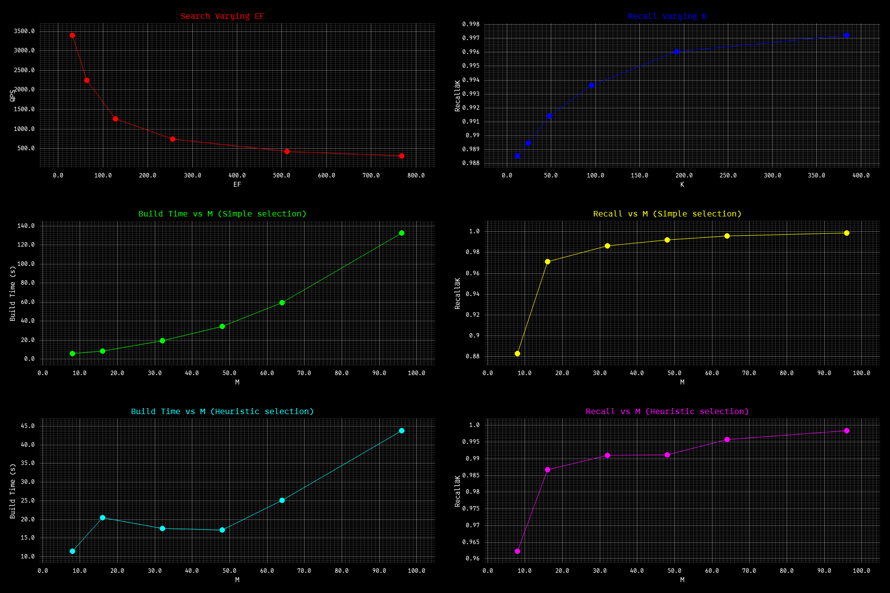

**Generic** implementation of **HNSW (Hierarchical Navigable Small World)** algorithm for approximate nearest neighbor
search. This is pretty much ["paper-compliant"](https://arxiv.org/pdf/1603.09320), its simplified, well documentated and
easy to understand & reason, while still being _reasonably_ efficient and robust, I guess. Its can be used to
`nearest-search` in **_any SPACE_** with given distance valid metric, for examples: vector, string, locations, image,
audio, bioinformatics etc.

Checkout this repo: [blaze-db](https://github.com/ronakgh97/blaze-db), `[ARCHIVED/ABANDON]`
a vector database built on top of this HNSW implementation.

**How to bench**?

Make sure to have cargo & this [dataset](https://huggingface.co/datasets/KShivendu/dbpedia-entities-openai-1M), and also
change [build config](.cargo/config.toml).

```shell
cargo bench --bench (32bit or 8bit)  -- ../../datasets/dim1536_size1M 4 # 32bit takes around 10+ mins!!!
                              <path to dataset> <num of files to read>
```

> NOTE: This lib uses [Portable SIMD](https://docs.rs/wide/latest/wide/index.html)
> and [x86_64 intrinsics](https://doc.rust-lang.org/core/arch/x86_64/index.html)
> for vector operations, so _peak performance_ can't be guaranteed on non-x86_64 targets, but it should still work &
> compile due to #[cfg].

Benched on I7 14650hx (rust 1.100.0, target: x86_64-pc-windows-msvc)

**_F32 Bench_**

```terminaloutput
# alg. 3 (simple, paper default): max_n: 16, ef_const: 96, max_l: 18, metrics: cosine

Total vectors: 153848, dimension: 1536
Index built in 178.8283733s with 864 insert/s
Size on disk: 988993949 bytes
Search with ef: 32, QPS: 3394.01
Search with ef: 64, QPS: 2239.09
Search with ef: 128, QPS: 1261.17
Search with ef: 256, QPS: 745.54
Search with ef: 512, QPS: 430.68
Search with ef: 768, QPS: 312.39

Recall@12: 0.9885, Time: 31.383041
Recall@24: 0.9895, Time: 31.091568
Recall@48: 0.9914, Time: 32.129105
Recall@96: 0.9936, Time: 33.59699
Recall@192: 0.9961, Time: 36.303165
Recall@384: 0.9972, Time: 37.741505

Simple selection
M: 8, Build Time: 5.6777s, Recall@32: 0.8828
M: 16, Build Time: 8.5468s, Recall@32: 0.9712
M: 32, Build Time: 19.3750s, Recall@32: 0.9864
M: 48, Build Time: 34.5587s, Recall@32: 0.9923
M: 64, Build Time: 59.3786s, Recall@32: 0.9960
M: 96, Build Time: 132.6781s, Recall@32: 0.9987

# same config varying M (Alg. 3), sample_size: 32540
# Note: ef_const IS scales with M (ef_const = max(96, 2*M)) during this run
Heuristic selection
M: 8, Build Time: 11.4489s, Recall@32: 0.9622
M: 16, Build Time: 20.5098s, Recall@32: 0.9867
M: 32, Build Time: 17.5490s, Recall@32: 0.9910
M: 48, Build Time: 17.1361s, Recall@32: 0.9912
M: 64, Build Time: 25.1512s, Recall@32: 0.9958
M: 96, Build Time: 43.8249s, Recall@32: 0.9984
```



**_I8 Bench_**

```terminaloutput
# same config as 32bit run

Total vectors: 153848, dimension: 1536
Index built in 106.3272728s with 1451 insert/s
Size on disk: 280081181 bytes

Search with ef: 32, QPS: 6145.19
Search with ef: 64, QPS: 3713.52
Search with ef: 128, QPS: 2138.31
Search with ef: 256, QPS: 1231.92
Search with ef: 512, QPS: 691.31
Search with ef: 768, QPS: 491.75

Recall@12: 0.9871, Time: 12.791706
Recall@24: 0.9892, Time: 12.764274
Recall@48: 0.9916, Time: 13.065743
Recall@96: 0.9939, Time: 13.513724
Recall@192: 0.9959, Time: 14.413967
Recall@384: 0.9970, Time: 16.277288

# other bench are not needed here, since they depend on the algorithm properties, not data type. 
```

> Last updated: 11/24/2026

**some observations**
on [commit](https://github.com/ronakgh97/hnsw-rs/commit/57aa9fd42877c267e22645d7821c1f671ed76896)

- `ef_const = max(96, 2*M)` ensures candidate pool scales with Mmax0 (2*M at layer 0) for both algorithm, but in this
  run, we keep it fixed at 96 to isolate the effect of M
- Alg. 3 (simple_selection): build time grows with M; recall improves monotonically
- Alg. 4 (heuristic_selection): build time peaks at M=8-16, then plateaus; recall peaks at M=32
- At high M, simple selection gets more connections from fixed ef pool → higher recall, but heuristic selection
  starves → lower recall, build time drops due to fewer distance computations, selection overhead dominates, then
  finally it caps due to selection is ef_const-limited, not M-limited
- Use `HNSW::with_options(..., use_heuristic_selection=true)` for Alg. 4

Ref:

- https://en.wikipedia.org/wiki/Curse_of_dimensionality
- https://arxiv.org/pdf/1603.09320
- https://arxiv.org/abs/2512.06636
- https://arxiv.org/pdf/2406.03482
- https://arxiv.org/html/2412.01940v1
- https://suif.stanford.edu/papers/lam-asplos91.pdf
- https://www.pinecone.io/learn/series/faiss/hnsw/
- https://www.techrxiv.org/users/922842/articles/1311476-a-comparative-study-of-hnsw-implementations-for-scalable-approximate-nearest-neighbor-search

> Note: Some of the ref are of my TODO list, I have not read them yet, but I think they are relevant, so I put them here
> for future reference.
