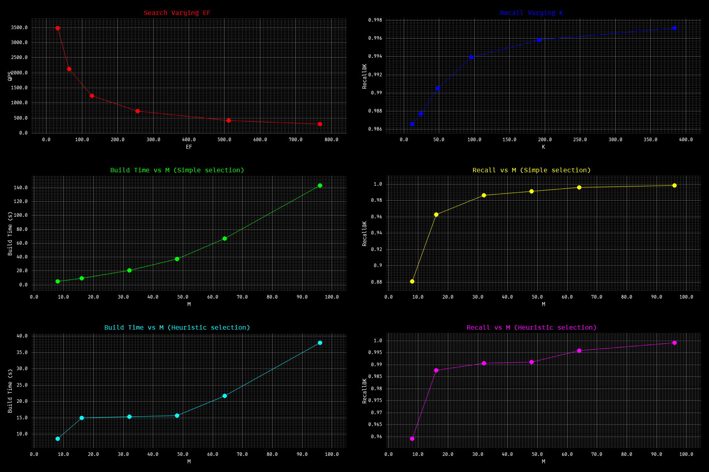

**Generic** implementation of **HNSW (Hierarchical Navigable Small World)** algorithm for approximate nearest neighbor
search.
This is pretty much ["paper-compliant"](https://arxiv.org/pdf/1603.09320), its simplified, well documentated and easy to
understand & reason, while still being _reasonably_ efficient and robust, I guess.
Its can be used to `nearest-search` in _any SPACE_ with given distance valid metric,
for examples: vector, string, locations, image, audio, bioinformatics etc.

Checkout this repo: [blaze-db](https://github.com/ronakgh97/blaze-db), [ARCHIVED/ABANDON] which is a vector database
built on
top of this HNSW implementation.

**How to bench**?

Make sure to have cargo & this [dataset](https://huggingface.co/datasets/KShivendu/dbpedia-entities-openai-1M),
and also change [build config](.cargo/config.toml).

```shell
cargo bench --bench bencher  -- ../../datasets/dim1536_size1M 4
                                         <path to dataset> <num of files to read>
```

```shell
# Alg. 3 (simple, paper default): max_n: 16, ef_const: 96, max_l: 18, metrics: cosine
Total vectors: 153848, dimension: 1536
Index built in 141.5677818s with 1091 insert/s
Search with ef: 32 took, QPS: 3523.23
Search with ef: 64 took, QPS: 2285.94
Search with ef: 128 took, QPS: 1375.67
Search with ef: 256 took, QPS: 796.74
Search with ef: 512 took, QPS: 454.85
Search with ef: 768 took, QPS: 325.76

Recall@12: 0.9885, Time: 30.7171
Recall@24: 0.9895, Time: 31.863916
Recall@48: 0.9919, Time: 32.321754
Recall@96: 0.9944, Time: 33.90104
Recall@192: 0.9959, Time: 35.229668
Recall@384: 0.9972, Time: 38.83932

Simple selection
M: 8, Build Time: 5.0802s, Recall@32: 0.8971
M: 16, Build Time: 8.3450s, Recall@32: 0.9661
M: 32, Build Time: 32.6053s, Recall@32: 0.9840
M: 48, Build Time: 37.9332s, Recall@32: 0.9907
M: 64, Build Time: 58.1063s, Recall@32: 0.9954
M: 96, Build Time: 128.2895s, Recall@32: 0.9987

# same config varying M (Alg. 3), sample_size: 32540
# Note: ef_const IS scales with M (ef_const = max(96, 2*M)) during this run
Heuristic selection
M: 8, Build Time: 8.2072s, Recall@32: 0.9609
M: 16, Build Time: 14.4271s, Recall@32: 0.9886
M: 32, Build Time: 13.3286s, Recall@32: 0.9921
M: 48, Build Time: 15.2372s, Recall@32: 0.9926
M: 64, Build Time: 22.1368s, Recall@32: 0.9968
M: 96, Build Time: 37.2041s, Recall@32: 0.9986
```

> Last updated: 7/26/2026

**some observations**
on [commit](https://github.com/ronakgh97/hnsw-rs/commit/57aa9fd42877c267e22645d7821c1f671ed76896)

- `ef_const = max(96, 2*M)` ensures candidate pool scales with Mmax0 (2*M at layer 0) for both algorithm, but in this
  run, we keep it fixed at 96 to isolate the effect of M
- Alg. 3 (simple_selection): build time grows with M; recall improves monotonically
- Alg. 4 (heuristic_selection): build time peaks at M=8-16, then plateaus; recall peaks at M=32
- At high M, simple selection gets more connections from fixed ef pool → higher recall, but heuristic selection
  starves → lower recall, build time drops due to fewer distance computations, selection overhead dominates, then
  finally it caps due to selection is ef_const-limited, not M-limited
- Use `HNSW::with_options(..., use_heuristic_selection=true)` for Alg. 4



Ref:

- https://en.wikipedia.org/wiki/Curse_of_dimensionality
- https://arxiv.org/pdf/1603.09320
- https://arxiv.org/abs/2512.06636
- https://arxiv.org/pdf/2406.03482
- https://arxiv.org/html/2412.01940v1
- https://www.pinecone.io/learn/series/faiss/hnsw/
- https://www.techrxiv.org/users/922842/articles/1311476-a-comparative-study-of-hnsw-implementations-for-scalable-approximate-nearest-neighbor-search

> Note: Some of the ref are of my TODO list, I have not read them yet, but I think they are relevant, so I put them here
> for future reference.
